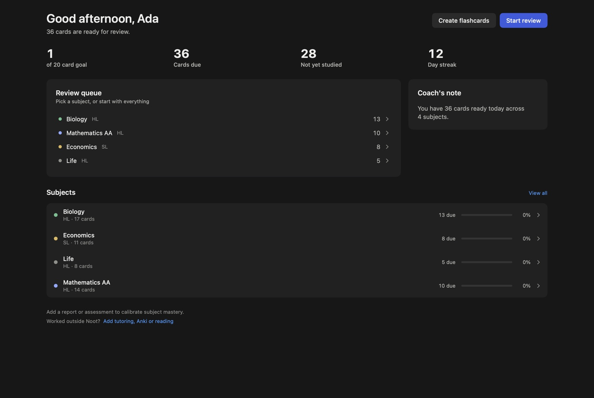
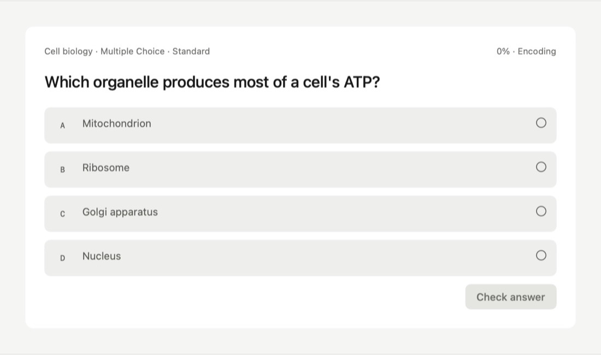
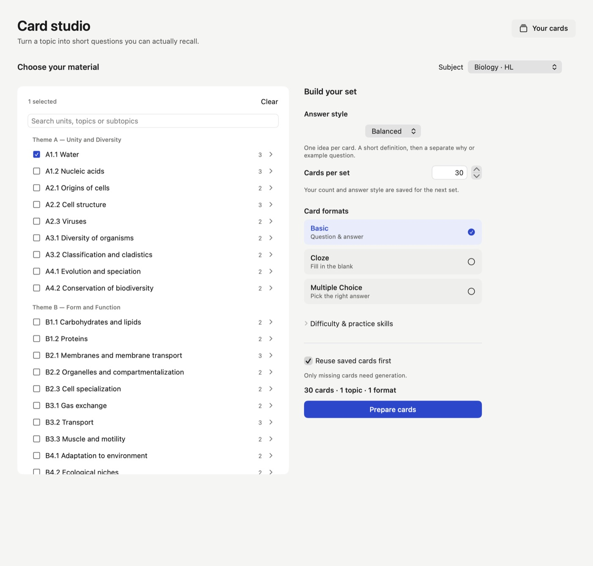
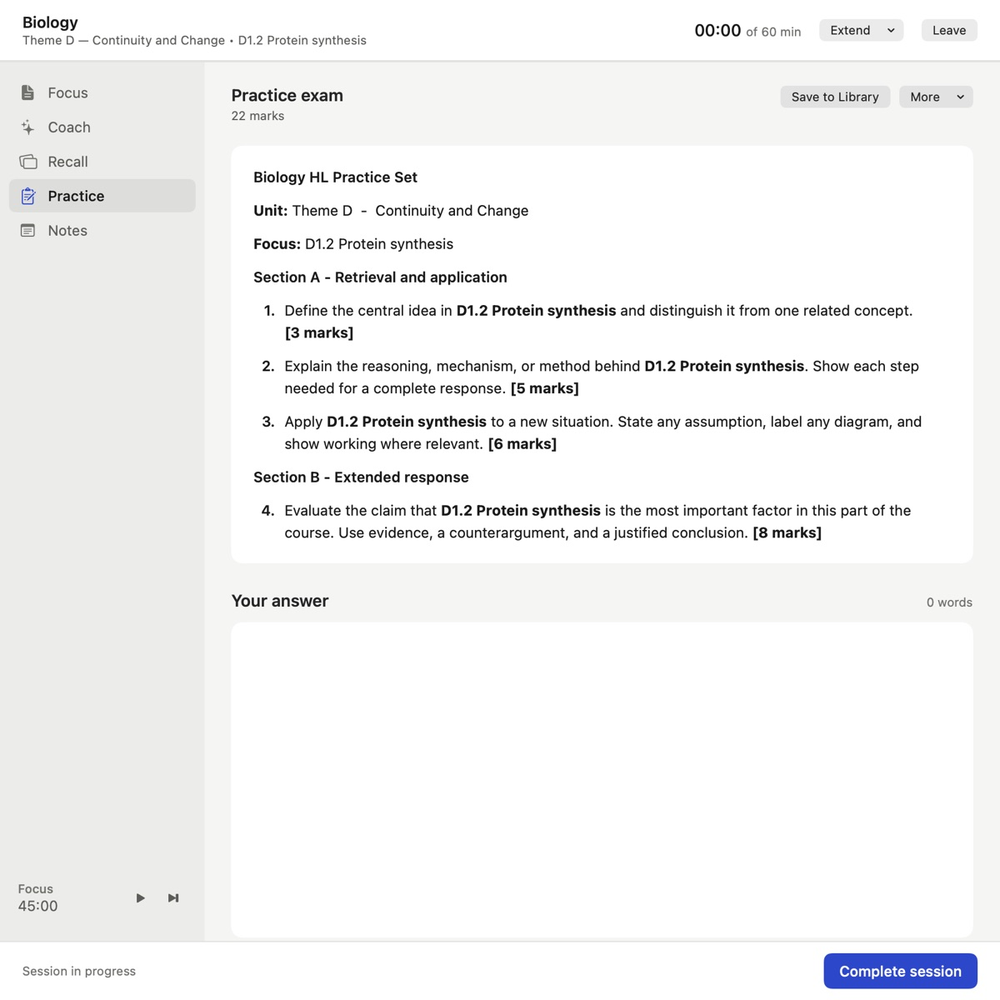
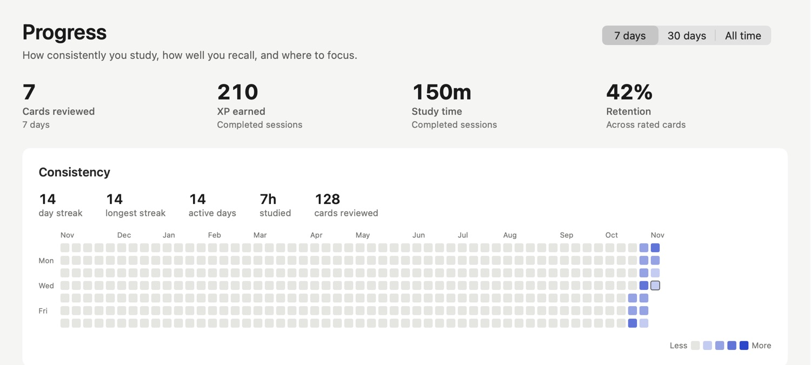

# Noot Study 2.0

**A native macOS workspace for flashcards, quizzes, practice exams, spaced review, and IB progress.**

Noot Study is a SwiftUI study app that keeps your library in SwiftData and connects it to the AI provider you choose through ARIA. Saved-card practice and scheduled review work without an AI connection.

[Release 2.0](https://github.com/leofratu/nootstudy/releases/tag/v2.0.0) · [Release notes](docs/releases/v2.0.0.md) · [What's new](#whats-new) · [Quick start](#quick-start) · [Build locally](#build-locally) · [Integrations](#integrations)

*Screenshots use synthetic study material. No personal study records, grades, credentials, or chat history are included.*

## What's new

The interface and study tools were reworked after 2.0. These changes are on `main` and are not part of the tagged 2.0 release.

| Area | Highlights |
| --- | --- |
| Design | Neutral paper and ink with one blue accent, no nested boxes, and quicker hover and page feedback. |
| Daily review | Your daily number is a goal you can review past. Reviews only stop there if you turn on **Stop reviews at my goal**. |
| Card Studio | A set can hold up to 200 cards, generated in slices so a failure keeps the cards already written. |
| Practice exams | Papers get enough time to generate, maths renders properly, and small provider mistakes no longer discard a paper. |
| Study sessions | A simpler header, a prompt to extend when planned time runs out, and the option to leave without logging. |
| Coach | ARIA now opens as a side panel next to your work, and Local Codex models stay in sync automatically. |
| Progress | A study heatmap with streaks, every rank with its unlock requirements, and research-based mastery levels. |
| XP | Study time now earns 5 XP per minute, plus a bonus for completing a session of 10 minutes or more. |
| Settings | Fewer sections, no duplicate controls, and rarely used AI options under **Advanced**. |

## Quick start

1. [Build and run locally](#build-locally) with Xcode on a Mac running **macOS 14 or later**.
2. Open Noot Study and choose your subjects. Existing installations keep their saved library and preferences.
3. Use **Library** to practise saved material or **Card Studio** to prepare a new set.
4. Configure an AI provider under **Settings → Coach & AI** for generation, tutoring, or marking.

This project publishes source, tags, and release notes. Builds and validation run locally; no app bundle, installer, ZIP, or DMG is attached.

## Study workflows

### Library and practice

Library search covers questions, answers, subjects, unit names, topics, subtopics, curriculum references, and saved test feedback.

- Filter by subject and unit, then select one or more topics.
- Start a multiple-choice quiz from filtered cards.
- Open a single result with **Answer question** or **Revise card**.
- Use **Show repeated cards** to inspect originals hidden by duplicate filtering.

Free Library practice does not change FSRS scheduling or consume the scheduled-review allowance. Use **Review** when you want recall ratings to update the learning schedule.

Multiple-choice attempts lock the submitted answer, identify the correct choice, show the saved answer for correction, and finish with a score. **Practise again** resets the attempt and reshuffles the options.

Basic cards use answer reveal. Cloze cards conceal their deletion until reveal. The same recall component is used in free practice, scheduled review, and study-session cards.

### Card Studio

Choose topics or subtopics across units and combine **Basic**, **Cloze**, and **Multiple Choice** formats. A set contains **1–200 cards total**, distributed across the selected topic and format combinations. Larger sets are requested in slices of 25, so a failure partway through keeps the cards already written.

**Reuse saved cards first** is enabled by default. If enough matching cards already exist, the set opens without a generation request. Otherwise, only the missing count is requested. Reused cards keep their IDs, scheduling, and review history.

New drafts can be edited before saving. Invalid multiple-choice options, malformed cloze blanks, and detected duplicates are rejected, while successful drafts remain available if another topic fails.

### Daily review

The review queue, subject screens, dashboard, reminders, and ARIA review actions share one view of your day. Your **daily goal** is a target, and you can keep reviewing past it. Each distinct card counts once per day, since local midnight.

To make the goal a hard stop, turn on **Settings → Flashcards → Stop reviews at my goal**. The remaining backlog then waits until tomorrow, and you can choose **Keep reviewing** at any point. Repeated copies are filtered from the queue without deleting their records.

### Practice exams

Open **Practice** during a study session to generate an original paper for the selected subject, course level, and topics. A paper can take a few minutes to write. Questions and mark schemes are stored separately, and the marks printed on the questions set the paper's total. If generation fails, you can retry or use the offline paper, which needs no AI.

Feedback includes criterion scores, evidence from the answer, corrections, a stronger example answer, and suggested practice. If a provider's criteria miss the paper's total, they are rescaled to it. Without a supplied mark scheme, feedback is labelled a **practice estimate** rather than an official IB grade.

Tests can be saved before or after marking and reopened under **Library → Tests** with their answers and feedback intact. The standalone exam marker is vaulted for now; existing tests and feedback remain saved.

## ARIA and AI providers

Use **Coach** in the toolbar to open ARIA beside your current page for explanations, revision, plans, grades, and progress. Explicit requests can create or edit supported app records. Destructive changes require an explicit request.

For revision and generation, ARIA can receive existing questions and answers with their IDs. This lets it reuse an existing learning point instead of creating a paraphrased duplicate when the meaning matches. Related questions that test different calculations, contrasts, or applications remain distinct.

| Provider | Setup |
| --- | --- |
| Local Codex | Use an installed, signed-in Codex CLI. Noot Study can detect the executable or use a path you provide. |
| Google Gemini | Add a Gemini API key and select a model. |
| Junali | Add the provider key and configure its compatible endpoint and model. |

Local Codex reads its available models and supported reasoning options from the installed CLI, refreshes them automatically, and keeps the last successful catalog for offline use. If a selected model is retired, the app moves to the new default; custom model IDs are left alone. The provider and model are in settings, with reasoning effort, answer detail, and web search under **Advanced**. Conversation context is managed automatically.

Study data remains local unless an AI feature is used. Selected context is then sent to the configured provider. API keys are stored in macOS Keychain, while Local Codex uses the existing CLI sign-in.

The desktop build is **not App Sandbox enabled** because Local Codex launches a local CLI process.

## Subjects, sessions, and progress

Noot Study includes IB curriculum browsing, scoped study sessions, FSRS scheduling, grades, achievements, and progress summaries. Sessions combine source material, retrieval practice, corrective feedback, notes, and exam transfer. Extend a running session by 15, 30, or 60 minutes without restarting it. **Leave** can save your progress or leave without logging, and the plan stays open either way.

**Progress** and **Profile** show a year of study activity with streaks, and every rank with its mastery requirements, including locked ranks. Logged study time earns a base of 5 XP per minute, adjusted by study intensity, and completing a session of 10 minutes or more earns a bonus. Rank follows mastery, not XP.

Each card moves through four mastery levels:

| Level | What it takes |
| --- | --- |
| Encoding | Studied, but not yet recalled reliably. |
| Retrievable | At least 2 reviews, with a successful recall. |
| Consolidating | 3+ successful recalls, predicted to hold for 7+ days, 65%+ accuracy. |
| Durable | 4+ successful recalls, predicted to hold for 21+ days, 85%+ accuracy. |

These levels build on research into [repeated retrieval](https://doi.org/10.1016/j.jml.2006.09.004), [spacing](https://doi.org/10.1111/j.1467-9280.2008.02209.x), and [successive relearning](https://doi.org/10.1037/a0023956), with memory stability predicted by FSRS. The exact cutoffs are this app's own choices, not values validated by those studies, and a level is not an exam grade or a prediction of one.

Practice feedback and academic evidence are kept separate: saved AI marking is not automatically converted into a school grade. Work completed elsewhere can be recorded as an external activity and merged into study history without double counting.

## Integrations

The [MCP connector](integrations/nootstudy-mcp/README.md) connects external tools to Noot Study's local integration bridge.

- **Local bridge:** enable it in **Settings → Integrations**. It binds to loopback, requires the app's bearer token, and exposes versioned APIs for supported study records. It is off by default.
- **MCP:** read study data and write back supported cards, reviews, sessions, plans, memories, or activities.
- **NotebookLM exchange:** export a study pack and import generated summaries or cards through the app's file workflow.

SwiftData remains the app's source of truth. Enabling an external connector does not turn the library into a cloud-sync service.

## Data and upgrades

The app keeps the bundle identifier **com.nootstudy.ibvault.app**. Upgrades prefer the existing application-container store and preserve legacy cards and history. Replacing the app bundle does not intentionally remove the study store.

Before moving to another Mac, use **Settings → Data & Backup**. Backups contain personal study data and should be kept private. If a store cannot be opened, the app preserves the original and its sidecars in a recovery folder before attempting a fresh store.

The repository and documentation exclude personal databases, backups, reports, credentials, and private course materials.

## Build locally

Development and release builds require a Mac. The project uses **Xcode 26**, Swift 6, and XcodeGen. Swift package versions are pinned in **project.yml**.

~~~bash
git clone https://github.com/leofratu/nootstudy.git
cd nootstudy
brew install xcodegen
xcodegen generate
open IBVault.xcodeproj
~~~

Select **IBVault** and run on **My Mac**. The project and module retain their historical **IBVault** name; the installed product is **Noot Study.app**.

Compile the Release configuration locally:

~~~bash
DEVELOPER_DIR=/Applications/Xcode.app/Contents/Developer \
xcodebuild build \
  -project IBVault.xcodeproj -scheme IBVault \
  -configuration Release -destination 'platform=macOS' \
  -derivedDataPath /tmp/nootstudy-build -jobs 2
~~~

The app is written to **/tmp/nootstudy-build/Build/Products/Release/Noot Study.app**. Version-tag pushes do not trigger a hosted release build; the existing hosted workflow is available only by manual dispatch.

### Run tests

~~~bash
DEVELOPER_DIR=/Applications/Xcode.app/Contents/Developer \
xcodebuild test \
  -project IBVault.xcodeproj -scheme IBVault \
  -destination 'platform=macOS' \
  -derivedDataPath /tmp/nootstudy-tests \
  -jobs 2 -parallel-testing-enabled NO
~~~

Both targets treat Swift warnings as errors. Regression coverage includes generation formats, reuse, test persistence, duplicate detection, local-midnight review limits, ARIA actions, scheduling, backups, and app commands. Provider responses use fixtures and test seams, so passing tests is not a live-provider quality claim.

<strong>Documentation screenshot harness</strong>

Documentation previews use an opt-in test harness with an in-memory demo library. Capture the preview windows with a separate screenshot tool; Noot Study does not capture the screen or request screen-recording permission.

~~~bash
TEST_RUNNER_NOOTSTUDY_SCREENSHOT_DIR=/tmp/nootstudy-screenshots \
DEVELOPER_DIR=/Applications/Xcode.app/Contents/Developer \
xcodebuild test -project IBVault.xcodeproj -scheme IBVault \
  -destination 'platform=macOS' -jobs 2 -parallel-testing-enabled NO \
  -only-testing:IBVaultTests/ReleaseScreenshotTests
~~~

The harness writes the current window title to **/tmp/nootstudy-screenshots/current-preview.txt**. After saving each screenshot, create its completion marker (**library.png.captured**, **card-studio.png.captured**, or **multiple-choice.png.captured**) in that directory to advance. Each preview waits up to three minutes.

### Repository map

~~~text
IBVault/
  ContentView.swift       Workspace navigation
  Design/                 Shared typography, colour, and controls
  Engine/                 Scheduling, limits, mastery, progression
  Models/                 SwiftData study and profile records
  Services/               AI, library reuse, tests, backups, integrations
  Views/                  Native SwiftUI screens
IBVaultTests/              Regressions and opt-in screenshots
docs/                      Screenshots and release notes
integrations/              MCP connector
project.yml                XcodeGen source of truth
IBVault.xcodeproj/         Generated, checked-in Xcode project
~~~

Keep source membership and **project.yml** in sync with **xcodegen generate**. Do not commit study stores, material folders, credentials, DerivedData, or raw screenshots containing personal information.

## License

Noot Study is licensed under the [MIT License](LICENSE).
